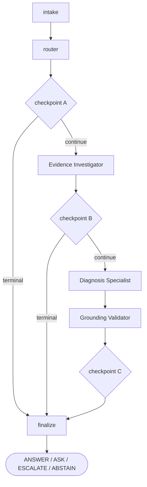

# Agent Reliability Case Study

[](https://github.com/anothersummerofsleep/agent-reliability-case-study/actions/workflows/ci.yml)

An evaluation-first LangGraph case study exploring how to make a small agent system measurable,
fail-closed, and improvable through evidence rather than prompt intuition.

The subject is a narrow equipment-operations incident-support agent for a fictional commercial-HVAC
family ("Northwind"). The agent itself is deliberately small. The engineering interest is the
reliability machinery around it: a deterministic decision policy the model cannot override, a
per-dimension evaluation harness over a frozen case set, and a disciplined loop for changing one
thing at a time and keeping or rejecting it on the evidence.

## Results at a glance

- **Evaluation set:** 22 frozen cases: 20 model-backed end-to-end cases and 2 deterministic
  fault-injection cases.
- **Offline test suite:** 107 deterministic tests (no API keys; model steps are injectable fakes).
- **Accepted behavioral interventions:** I1 (Diagnosis confidence/answer coupling), I2 (monotonic
  Investigator conflict preservation), I5 (live-telemetry evidence-source semantics).
- **Rejected/falsified, preserved as evidence:** I3, I4, I6, I7.
- **Release:** `v0.1.0`.

The strongest single result is Intervention 1, measured with a repeated **5-control / 5-treatment** A/B
(not a single run). These are the per-arm means of that one experiment:

| Dimension (Intervention 1 A/B) | Control mean | Treatment mean |
| --- | ---: | ---: |
| Decision correctness | 13 / 20 | 16 / 20 |
| Structured-output validity | 15 / 20 | 18.4 / 20 |
| Grounding correctness | 2.4 / 7 | 5.6 / 7 |
| High-confidence + null-answer states | 5.0 | 1.6 |

These numbers describe **Intervention 1's control/treatment experiment specifically**, not a universal
before/after for the whole system. They are descriptive, `n = 5` per arm, and are **not** a
statistical-significance claim. The full I1 to I7 history, including what each change tested and why it
was kept or reverted, is in [`docs/experiment-history.md`](docs/experiment-history.md).

## The core loop

Every behavioral change in this project goes through the same loop:

**specify → evaluate → inspect failures → form a falsifiable hypothesis → change one thing → rerun the same evaluation set → keep or reject the change**

A change is accepted only when the frozen evaluation set shows it helps on its target without a clear
regression elsewhere, where "clear" is judged against observed run-to-run variance rather than any
single run. When a single run is too noisy to separate a real effect from model nondeterminism, the
change is measured with a repeated stochastic A/B instead of a single pass. Falsified and rejected
experiments are kept in the record, not deleted: the reliability story is as much about what was
withdrawn as what was kept.

## Current status

- Baseline v1 captured and preserved (poor dimensions kept as evidence, not tuned away).
- A full cycle of seven controlled interventions (I1 to I7) completed, each measured against the frozen
  set; repeated stochastic A/B used where single-run variance was insufficient.
- The active accepted implementation contains **Intervention 1** (Diagnosis confidence/answer coupling),
  **Intervention 2** (monotonic Investigator conflict preservation), and **Intervention 5** (distinguishing
  genuine telemetry acquisition from generic missing evidence), plus evaluator mechanism-state and triage
  auditability instrumentation.
- The rejected and falsified interventions (I3, I4, I6, I7) and their artifacts are preserved as
  historical evidence, not deleted.
- The full I1 to I7 experiment history, including what each change tested and why it was kept or reverted,
  is in [`docs/experiment-history.md`](docs/experiment-history.md) (the authoritative record). The sections
  below summarize only what is needed to understand the active system.

## Architecture

An incident is routed, investigated, diagnosed, grounded, and finalized. Three deterministic policy
checkpoints sit between the stages. The model produces assessments and a diagnosis, but it never
chooses the final workflow action: a pure policy function does, evaluated at each checkpoint.



- **Router** classifies the incident as `INVESTIGATE` or `OUT_OF_SCOPE`.
- **Evidence Investigator** gathers and assesses evidence (details below).
- **BM25 Northwind retrieval** supplies manual passages when the Investigator asks for them.
- **Diagnosis Specialist** produces a structured diagnosis from the incident facts and evidence.
- **Grounding Validator** checks whether the proposed answer is supported by that evidence.
- **Deterministic policy checkpoints** decide the final action.

The final decision is always one of `ANSWER | ASK | ESCALATE | ABSTAIN`.

### Progressive state and fail-closed behavior

State is progressive: a later stage's fields are absent until that node runs. The policy is written so
a missing value never silently satisfies a later rule. Boolean guards use explicit identity comparisons
(`is True`, `is False`) rather than truthiness tests, so `None` means "not yet known" and is never
coerced into a decision. Where a stage cannot produce a trustworthy result, the system fails closed to an escalation
rather than guessing:

- a Diagnosis parse failure leaves confidence unset and escalates as an internal error;
- a Grounding failure leaves `answer_grounded` as `None` (not `False`) and escalates, rather than
  silently rejecting a possibly-correct answer.

## Evidence Investigator

The Investigator is bounded by design: it is not an open-ended ReAct loop. It:

- normalizes the incident into provenance-bearing evidence;
- decides via a triage step whether retrieval is needed;
- retrieves from the fictional Northwind corpus when warranted, capped at a small number of attempts;
- assesses sufficiency and whether the evidence conflicts;
- identifies whether a missing detail is requester-resolvable;
- exposes tool failure cleanly (a live-telemetry request has no backend and fails closed to a tool
  failure rather than fabricating data).

## Retrieval

Retrieval is intentionally simple:

- the corpus is 10 fictional Northwind documents parsed from `datasets/corpus/manuals.md`;
- retrieval is a hand-rolled Okapi BM25 with `k=2` and no new dependencies;
- relevant documents and two deliberate distractors (`DOC-RTU-CYCLE`, `DOC-AHU-VFD`) are both present.

Simplicity is the point: retrieval quality is measured as an evaluation dimension rather than hidden
behind heavier infrastructure. If retrieval became the limiting factor, the evaluation would show it.

## Diagnosis Specialist

The Diagnosis Specialist receives the incident facts and the provenance-bearing evidence and returns a
structured output (confidence, hypotheses, and an optional proposed answer). It is closed-domain:
because Northwind is fictional, the model must reason from the supplied evidence and must not use
real-world HVAC knowledge to manufacture a gold answer the evidence does not support.

## Grounding Validator

The Grounding Validator has one narrow job: **are the substantive claims in the proposed answer
supported by the supplied evidence?** It does not diagnose, retrieve, rewrite, or loop. Its only
output feeds the policy's grounding check.

## Deterministic policy

A single pure function encodes the decision rules and is evaluated at the three checkpoints; returning
`None` means "continue". The ladder is ordered, and `ANSWER` is the only positive rule, never a
fallthrough. Representative rules:

- safety-critical incident → `ESCALATE` (safety, above everything else);
- out of scope → `ABSTAIN`;
- tool failure after bounded retry → `ESCALATE`;
- requester-resolvable evidence conflict → `ASK`; unresolvable conflict → `ESCALATE`;
- high confidence but no proposed answer → `ESCALATE` (a contract violation, caught as internal error);
- a proposed answer the evidence does not support → `ESCALATE` (grounding failure);
- a supported, sufficiently-confident answer → `ANSWER`.

## Evaluation design

The frozen set is 22 cases: 20 end-to-end (E2E) cases that drive the full model-backed graph, and 2
deterministic fault-injection cases used as unit tests. Each dimension is scored separately. There is
deliberately **no composite "agent score"**, because a single number hides exactly the per-dimension
failures this project exists to study.

Dimensions:

- route correctness
- decision correctness
- reason correctness (the escalation/abstain reason, where one is expected)
- retrieval behavior (did it retrieve when it should, and not when it should not)
- retrieval source (did it pull the right documents)
- distractor resistance
- structured-output validity
- grounding correctness
- latency

## Baseline v1

Baseline v1 is the first honest measurement of the real implementation, preserved unchanged.

- Model: `google_genai:gemini-3.8-flash`
- Frozen implementation under test: commit `526745c`
- Scope: 20 E2E cases

| Metric | Baseline v1 |
| --- | ---: |
| Route correctness | 20 / 20 |
| Decision correctness | 12 / 20 |
| Reason correctness | 7 / 10 |
| Retrieval behavior | 18 / 20 |
| Retrieval source | 9 / 10 |
| Grounding correctness | 1 / 7 |
| Output-contract validity | 20 / 20 |
| Structured-output validity | 14 / 20 |
| Distractor resistance | 17 / 20 |

The weak dimensions (grounding and decision correctness especially) were recorded and left in place.
A poor baseline that is honestly measured is more useful than a good-looking one that was tuned before
anyone looked at where it failed.

## Controlled improvement loop

### Intervention 1: Diagnosis answer consistency (accepted)

Baseline inspection surfaced a failure cluster: the Diagnosis step would report `confidence=high` while
leaving `proposed_answer=None`, a self-contradiction the policy then had to treat as an internal error.
The intervention was a prompt change coupling confidence to the presence of an answer.

A single-run A/B was too noisy to trust (control decision correctness alone ranged 11 to 15 of 20
across runs), so the effect was measured with a repeated 5-control / 5-treatment protocol, arms
alternated and run sequentially.

| Metric | Control mean | Treatment mean |
| --- | ---: | ---: |
| Decision correctness | 13 / 20 | 16 / 20 |
| Structured-output validity | 15 / 20 | 18.4 / 20 |
| Grounding correctness | 2.4 / 7 | 5.6 / 7 |
| High-confidence + null-answer states | 5.0 | 1.6 |

Treatment decision correctness was higher in all 5 paired slots. This is descriptive evidence across
5 runs per arm, not a statistical-significance claim. Intervention 1 was accepted.

### Intervention 2: Investigator conflict preservation (accepted)

The Investigator's triage step could detect an evidence conflict that the later reassessment step then
erased, losing a signal the policy needed. The fix made the final Investigator conflict monotonic:
`final_conflict = triage_conflict OR reassessment_conflict`.

Conflict survival on the target case improved from 0/10 to 5/5. The unresolvable-conflict case
(ARC-08) stayed correct (`ESCALATE(conflict_unresolvable)` 5/5), and across the 5 treatment runs
scanned, no non-conflict case acquired a spurious conflict. Overall decision correctness did not move,
because a separate downstream issue
(gap-resolvability classification) still gated the target case. Intervention 2 is retained as a
correctness fix regardless of the flat headline score: it preserves a signal that was being silently
dropped.

### Intervention 3: conflict-resolvability prompt (falsified, reverted)

An attempt to tell the reassessment step how to classify conflict resolvability. It was falsified: the
reassessment step did not believe the conflict existed in the first place (its own conflict read was
`False`), so a prompt gated on a perceived conflict never engaged. Reverted. The lesson: a prompt that
depends on a belief the model does not hold cannot change behavior.

### Intervention 4: pass prior conflict into reassessment (partially supported, rejected and reverted)

A coupled state-plumbing and prompt change: pass the triage-detected conflict into the reassessment
step as prior context, so it would classify resolvability of an already-observed conflict even when its
own read differed. The mechanism worked (the missing resolvability classification was eliminated, 0/5
`None`), but at the system level it did not pay off: the target case reached `ASK` only 1/5 because the
model usually judged the conflict requester-unresolvable, and the conflict-resolvability prompting
introduced a spurious `ASK` on a clean case 2/5. Net decision correctness stayed flat. It was rejected
and reverted.

The experiment is preserved under `baselines/intervention-04/`. It is useful evidence that a working
mechanism is not sufficient grounds to keep a change: a mechanism improvement that introduces a
system-level regression should still be rejected.

### Intervention 5: telemetry vs missing evidence (accepted)

On ARC-03 the Investigator used `needs_live_telemetry` as a generic "more information needed" signal, so
it tried the backendless telemetry tool, failed, never retrieved, and the policy produced an
accidentally-correct `ESCALATE(tool_failure)` with the wrong evidence path and reason. The triage prompt
was narrowed so telemetry means a genuine current-reading/telemetry-tool acquisition. After the change,
ARC-03 stopped requesting telemetry (5/5), retrieved the correct document (5/5), and the tool-failure was
eliminated, while the deliberate telemetry-failure case ARC-06 kept its telemetry path and
`ESCALATE(tool_failure)` (5/5). ARC-03's final gold reason was still wrong, because repairing the
evidence path exposed a separate sufficiency problem downstream, so I5 is kept for the corrected mechanism
rather than a headline score gain. Lesson: an accidentally-correct decision can hide an incorrect mechanism.

### Interventions 6 and 7, and the current direction

Two later interventions were run and reverted: I6 (a shared evidence-sufficiency definition) and I7
(Diagnosis confidence calibration). Both were partially informative but neither was accepted, and together
they indicated that the remaining failures are most consistently explained by an information-loss boundary
between evidence gathering and Diagnosis rather than by further prompt wording. That finding, the full
per-run numbers, and a design-only architecture review (future work, not implemented) are documented in
[`docs/experiment-history.md`](docs/experiment-history.md).

**The recurring lesson across the reverted experiments (I3, I4, I6, I7): failed and rejected experiments
remain part of the reliability record.**

## Reproducibility

The deterministic suite runs fully offline. Every model-backed step is injectable, so the tests use
fake models and need no API keys.

```bash
uv sync --extra dev
uv run pytest
```

To exercise the real graph on a single incident (needs live credentials):

```bash
cp .env.example .env     # fill in the model and optional tracing keys
uv run python -m agent_reliability.graph "RTU-40 unit 3 tripped NW-A11, discharge 415 psi, coil fouled"
```

To run a local evaluation, write to a non-canonical output path:

```bash
uv run python -m agent_reliability.evaluate baselines/local-run.json
```

Do not overwrite the canonical `baselines/baseline-v1.json` (or any committed intervention artifact):
those are the preserved record. Secrets are read from the environment only, and `.env` is gitignored.
LangSmith tracing is optional and is not required for the persisted evaluation workflow.

## Continuous integration

A GitHub Actions workflow ([`.github/workflows/ci.yml`](.github/workflows/ci.yml)) runs on every pull
request and every push to `main`. It installs the exact dependency set pinned in `uv.lock` on Python 3.11
and runs the offline deterministic test suite with `pytest`. It uses no secrets and makes no model calls,
so it has no inference cost and does not write to any committed evaluation artifact.

CI does not run the model-backed evaluation (`agent_reliability.evaluate`) or live graph runs. Those need
credentials, cost money per run, and are stochastic, so they stay manual, and their results are the
committed artifacts under `baselines/`. A green CI run means the deterministic parts (contracts, policy,
safety detector, retrieval, the nodes' fail-closed paths with fake models, and the scoring harness) behave
as tested. It is not new evidence about model-level decision quality.

## Repository layout

```
src/agent_reliability/   contracts, enums, deterministic policy, safety detector, router, graph,
                         nodes (Investigator / Diagnosis / Grounding), BM25 retrieval, model,
                         dataset, evaluate (baseline + scoring harness)
datasets/                the 22 frozen seed cases + the fictional Northwind corpus
baselines/               Baseline v1, controlled-intervention results, and repeated stochastic A/B
                         artifacts (see baselines/README.md)
tests/                   offline deterministic tests (contracts, policy, safety, dataset, retrieval,
                         investigator, diagnosis, grounding, evaluate, graph)
docs/decisions/          architecture decision records
```

## Scope and limitations

This is a portfolio-scale engineering case study, not a production deployment.

- The Northwind domain is fictional: no employer, customer, or proprietary data of any kind.
- No real production traffic, authentication, SLOs, or user base.
- The corpus is tiny and closed-domain; retrieval is a BM25 baseline.
- There is no real telemetry backend; a telemetry request is designed to fail closed.
- Model behavior is stochastic, which is why effects are measured with repeated runs rather than
  asserted from a single pass.
- Intervention conclusions rest on small samples (5 runs per arm) and a single model and provider;
  they describe observed direction, not a general or significance-tested result.
- Interventions are selected and judged against the same frozen case set, so there is a standing
  test-set adaptation risk: gains measured on these cases may not transfer to unseen incidents.

## Future validation directions

`v0.1.0` is a completed milestone, not an unfinished draft. The items below are candidate validation
questions that future releases **may** explore; none is a committed deliverable or a missing requirement
of v0.1.0, and none is implemented today.

- **Unseen holdout evaluation:** a genuinely unseen case set built after the I1 to I7 development cycle,
  to test whether the accepted interventions transfer beyond the frozen cases and to reduce the
  test-set adaptation risk noted above.
- **Metamorphic / perturbation testing:** paraphrased incidents, reordered evidence, irrelevant wording
  changes, and benign distractor additions, checking whether decisions and reasoning stay stable when
  the underlying facts do not change.
- **Adversarial evidence testing:** conflicting passages, stronger distractors, unsupported claims,
  prompt-injection-like instructions embedded in retrieved material, and provenance-manipulation
  attempts, to probe whether evidence boundaries, provenance handling, grounding, and the deterministic
  policy stay reliable under misleading input. The current system is not claimed to be hardened against
  these.
- **Expanded fault injection:** extending the deterministic philosophy of the current ARC-19/20 cases to
  malformed structured output, model/API timeouts, other provider errors (rate limiting, an unavailable
  or retired model), retrieval failure, repeated tool failure and retry exhaustion, missing, partial, or
  contradictory graph state, Grounding-validator failure, and unavailable evidence sources.
- **Concurrency and resource boundaries:** running cases in parallel to check that no state leaks
  between runs, and that each case stays within bounded time, model-call, and retry budgets under
  provider throttling.
- **Cross-model / provider replication:** repeating selected experiments on another supported
  model/provider, to separate architecture-level findings from ones specific to Gemini 3.8 Flash. No
  model-independence is claimed today.
- **Confidence and selective-decision calibration:** whether confidence levels and the
  `ANSWER | ASK | ESCALATE | ABSTAIN` behavior are calibrated against observed correctness and
  uncertainty, which is broader than maximizing decision correctness.
- **Retrieval stress testing:** the BM25 baseline under larger corpora, higher distractor density,
  lexical mismatch, near-duplicate evidence, and different `k`, to find where retrieval becomes the
  limiting component rather than replacing it preemptively.
- **Deterministic invariant / property testing:** property-based checks for safety precedence,
  fail-closed terminal behavior, monotonic conflict preservation, output-contract validity, impossible
  state combinations, and policy invariance to irrelevant state.
- **Reproducibility / framework-drift checks:** re-running the project against newer compatible versions
  of LangGraph, LangChain, and the provider integrations, without changing the v0.1.0 historical artifacts.
- **Latency and cost characterization:** latency distributions, token usage, model-call counts, and cost
  per case, kept as separate metrics rather than collapsed into a composite score.
- **Operational observability:** whether the recorded run artifacts and optional traces are enough to
  locate the first stage where a failed case diverged, without rerunning it.

Separately, one specific architectural experiment, a persisted "diagnostic shape" representation (I8), is
already scoped as design-only in [`docs/experiment-history.md`](docs/experiment-history.md); it is distinct
from the broader validation directions above and is likewise unimplemented.

## License

Released under the [MIT License](LICENSE).
